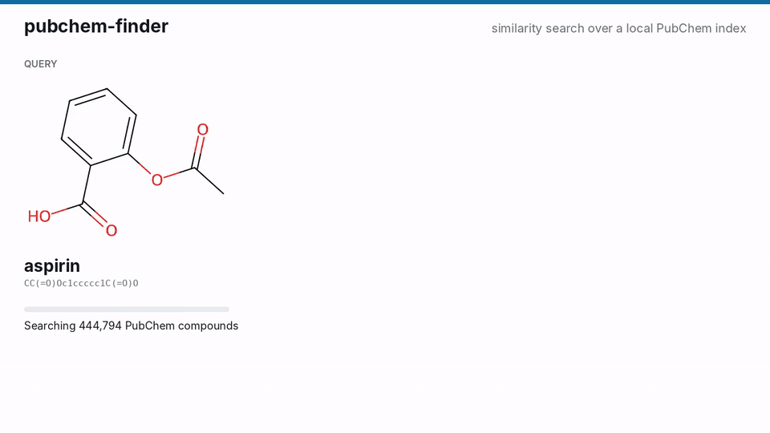
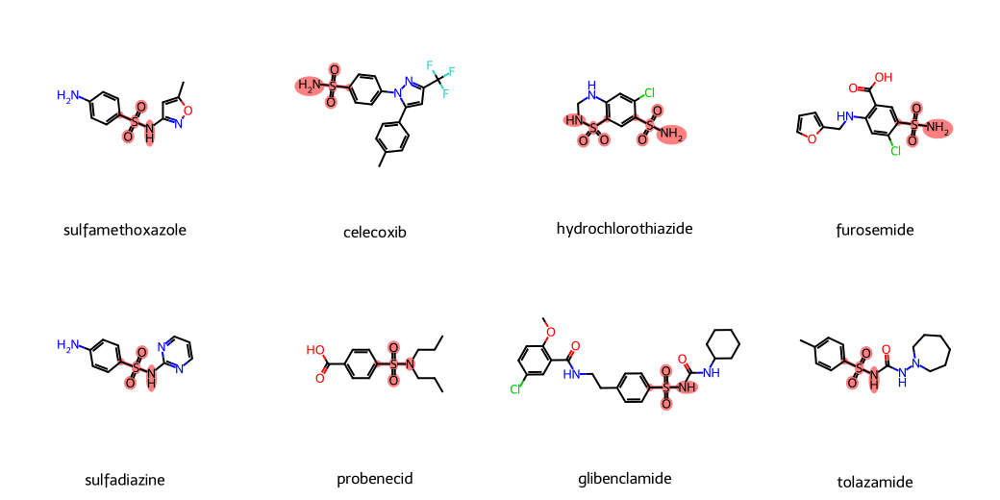
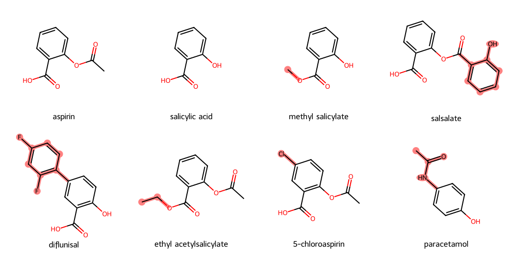

# PubChem Finder

Search [PubChem](https://pubchem.ncbi.nlm.nih.gov/) by chemical structure from your
terminal or from Claude. PubChem Finder builds a local fingerprint index of PubChem (all
of it, or the slice you need) for exact similarity and substructure search with no rate
limits, wraps PubChem's live services for names, safety data and bioassays, and adds RDKit
chemistry: structure drawings, med-chem triage and descriptors. Local search works from the
first question, on a built-in set of 1,932 FDA-approved drugs, until you build a PubChem
index. It runs as a command-line tool, a Python library and an
[MCP](https://modelcontextprotocol.io/) server for Claude Desktop, Claude Code and other MCP
clients.

[](https://pypi.org/project/pubchem-finder/)
[](https://pypi.org/project/pubchem-finder/)
[](https://github.com/MysterionRise/pubchem-finder/actions/workflows/ci.yml)
[](https://github.com/MysterionRise/pubchem-finder/blob/master/LICENSE)
<!-- mcp-name: io.github.MysterionRise/pubchem-finder -->



*Real searches over the first 444,794 compounds of PubChem, rendered from the index the
project's real-data workflow builds: similarity hits for aspirin with the atoms that differ
from it highlighted, then hits for an aryl sulfonamide SMARTS with the match highlighted.
[MP4 version](https://raw.githubusercontent.com/MysterionRise/pubchem-finder/master/docs/media/search-demo.mp4).*

## Why this one

Other PubChem tools, MCP servers and hosted connectors included, forward questions to
PubChem's web API. That works for looking compounds up, but structure search through the
API is rate-limited, times out on generic queries and returns unscored samples. PubChem
Finder also keeps a local index:

- **Exact, scored similarity search** over every indexed compound (ECFP4 Tanimoto by
  default) in milliseconds, using [FPSim2](https://github.com/chembl/FPSim2), the engine
  behind ChEMBL's similarity search.
- **Local substructure search** with SMILES or SMARTS: a fingerprint screen, then an
  atom-by-atom match, so every hit is a real match.
- **Offline chemistry** with RDKit: descriptors, standardization, PAINS/Brenk/NIH alerts,
  QED, synthetic accessibility, and drawings that show what changed between analogues.
- **PubChem knowledge, cited:** synonyms and CAS numbers, cross-references, GHS
  classification, pharmacology, toxicity and bioassay summaries, each with its source.

No database server, no Docker: the index is a pair of files in your data directory.

## Use it from Claude

Requires [uv](https://docs.astral.sh/uv/getting-started/installation/), which fetches
Python and everything else on first run.

**Claude Code:**

```bash
claude mcp add pubchem-finder -- uvx --python 3.14 pubchem-finder mcp
```

or as a plugin, which also works in Cowork:

```
/plugin install pubchem-finder --marketplace MysterionRise/pubchem-finder
```

**Claude Desktop** (Settings, Developer, Edit Config, then restart Claude):

```json
{
  "mcpServers": {
    "pubchem-finder": {
      "command": "uvx",
      "args": ["--python", "3.14", "pubchem-finder", "mcp"]
    }
  }
}
```

Then ask things like:

- "What is the molecular weight and XLogP of caffeine? Is it Lipinski-compliant?"
- "Is ibuprofen hazardous? What does its GHS label say? Cite the sources."
- "What are the main targets of celecoxib in PubChem bioassays?"
- "Show me the closest analogues of aspirin and highlight what changed."
- "Does this compound have any PAINS alerts? `O=C1C(=Cc2ccccc2)SC(=S)N1`"
- "Find the 20 compounds most similar to ibuprofen" or "Which indexed compounds contain an
  aryl sulfonamide? Draw a few with the group highlighted." (local search: the demo set of
  FDA-approved drugs until you build an index)



*`draw_molecules` with `highlight="smarts"`: eight sulfonamide drugs with the match for
`[NX3][SX4](=O)(=O)c` highlighted, as Claude shows it inline.*

Local similarity and substructure search work from the first question: until you build
an index, they search a built-in demo set of 1,932 FDA-approved drugs (built in about a
second on first use) and say so. Build a PubChem index from the command line (below) and
the server switches to it, no restart needed. To use a non-default data directory, add
`"env": {"PUBCHEM_FINDER_HOME": "/path"}` to the Claude Desktop entry, or
`--env PUBCHEM_FINDER_HOME=/path` to `claude mcp add`.

**Other MCP clients:** the server speaks standard MCP over stdio, so any client that runs
local MCP servers (Cursor, VS Code, Windsurf, Zed, JetBrains IDEs, Codex CLI, LM Studio...)
can start it with the same command and arguments. It is listed in the
[MCP registry](https://registry.modelcontextprotocol.io) as `io.github.MysterionRise/pubchem-finder`
for clients that install servers from there.
[docs/clients.md](https://github.com/MysterionRise/pubchem-finder/blob/master/docs/clients.md)
has the settings, a quick check, and setups people have tested; if you use one of those
clients, adding yours there is a good first contribution.

**Over HTTP:** `pubchem-finder mcp --transport http` serves the same tools at
`http://127.0.0.1:8000/mcp` (MCP streamable HTTP) for clients that connect to a URL
rather than start a process, and for one shared index on a team machine. For example,
`claude mcp add --transport http pubchem-finder http://127.0.0.1:8000/mcp`. The server has
no authentication or TLS of its own: read
[Over HTTP](https://github.com/MysterionRise/pubchem-finder/blob/master/docs/clients.md#over-http)
before binding it to anything but `127.0.0.1`.

### Tools

| Tool | What it does |
|---|---|
| `pubchem_lookup(query, by, limit)` | Resolve a name, CID, SMILES or InChIKey to PubChem records: identifiers, formula, MW, XLogP, H-bond counts, TPSA, link. |
| `compound_properties(smiles)` | RDKit descriptors and Lipinski check for any SMILES. Offline. |
| `standardize(smiles)` | Remove salts and counter-ions, neutralize, canonicalize; says what it removed. Offline. |
| `compare(smiles_a, smiles_b)` | Tanimoto similarity on ECFP4 and MACCS fingerprints. Offline. |
| `medchem_profile(smiles)` | QED, synthetic accessibility, Lipinski/Veber, PAINS/Brenk/NIH alerts with atoms, Murcko scaffold. Offline. |
| `draw_molecules(smiles, legends, highlight, smarts, reference_smiles)` | Structures as an inline image, highlighting a SMARTS match, what changed relative to a reference, or a similarity map. Offline. |
| `similarity_search(smiles, threshold, top_k, metric, group_by_scaffold)` | Most similar compounds in the local index (the demo set until one is built), optionally grouped by Murcko scaffold. |
| `substructure_search(query, query_type, max_hits)` | Indexed compounds containing a SMILES or SMARTS fragment, lowest CID first. |
| `index_status()` | Whether the local index is built, what it holds, what local searches cover now, and how to build what is missing. |
| `pubchem_similarity_search(smiles, threshold, max_records)` | Similar compounds across all of PubChem, live, re-scored with ECFP4. |
| `pubchem_substructure_search(smiles, max_records)` | Compounds across all of PubChem that contain a fragment, live. |
| `pubchem_exact_match(smiles, identity_type)` | The PubChem record(s) for exactly this structure, optionally ignoring stereo or isotopes. |
| `pubchem_synonyms(cid, limit)` | Common, brand and systematic names, plus CAS Registry Numbers. |
| `pubchem_xrefs(cid)` | Registry IDs (CAS, ChEMBL, DrugBank...), PubMed articles and patents. |
| `pubchem_description(cid)` | Curated descriptions, with sources. |
| `pubchem_annotations(cid, heading, max_chars)` | One section of the compound page: GHS classification, hazards, pharmacology, mechanism of action, drug information, experimental properties, toxicity, use, food additives. Every item names its source. |
| `pubchem_bioactivity(cid)` | Bioassay summary: assay count, outcomes, top targets (one per gene), lowest potency values (IC50, Ki...) among active results. |

### Prompts and resources

Prompts start a whole workflow by name. In Claude Code they are slash commands, such as
`/pubchem-finder:compound_dossier aspirin`; each argument is one word (a SMILES works, and
a list is comma-separated without spaces).

| Prompt | What it does |
|---|---|
| `compound_dossier(compound)` | A cited profile of a compound (name, CID or SMILES): identity, structure, drug-likeness, GHS safety, pharmacology, bioassay targets. |
| `find_analogues(compound, threshold)` | Close analogues grouped by scaffold and drawn with what changed; also asks PubChem when only the demo set was searched. |
| `triage_structures(structures)` | Medicinal-chemistry triage of `SMILES,SMILES,...`, ranked, with the structural alerts drawn. |

Resources are data a client can attach to a conversation: `pubchem://compound/{cid}` (a
PubChem compound record as JSON; in Claude Code, `@pubchem-finder:pubchem://compound/2244`)
and `pubchem://index/status`.

## Use it from the command line

```bash
uvx --python 3.14 pubchem-finder lookup caffeine                # PubChem record by name (--by cid, smiles or inchikey for those)
uvx --python 3.14 pubchem-finder props "CC(=O)Oc1ccccc1C(=O)O"  # RDKit descriptors (offline)
```

`uvx` runs the package without installing it; `--python 3.14` keeps uv off Python 3.15
(see [Troubleshooting](#troubleshooting)). To install the command once:
`uv tool install --python 3.14 pubchem-finder` (or `pip install pubchem-finder` on Python
3.11 to 3.14). The examples below
assume it is installed. To try the development version, replace `pubchem-finder` with
`--from git+https://github.com/MysterionRise/pubchem-finder pubchem-finder` in any `uvx`
command.

### Build a local index and search it

```bash
pubchem-finder index build --limit 1 --with-substructure   # first PubChem chunk: ~445,000 compounds
pubchem-finder search "CC(=O)Oc1ccccc1C(=O)O" --threshold 0.7 --top 20
pubchem-finder search "CC(=O)Oc1ccccc1C(=O)O" --group-by-scaffold
pubchem-finder substructure "c1ccc2[nH]ccc2c1"              # everything indexed that contains indole
pubchem-finder substructure "[NX3][SX4](=O)(=O)c" --smarts  # aryl sulfonamides, as SMARTS
pubchem-finder index status

pubchem-finder index build --sdf my_library.sdf.gz         # or index your own SDF files
```

Before any index is built, `search` and `substructure` use the built-in demo set: 1,932
FDA-approved drugs (PubChem's parent compounds of what it links to Drugs@FDA), built into
`<data directory>/demo` in about a second on first use, and the results say so
(`search_scope: "demo"` in JSON). `index build --demo` builds it ahead of time;
`PUBCHEM_FINDER_DEMO=0` turns the fallback off. Once a PubChem or SDF index is built,
searches use it.

`index build --limit N` downloads the first N of PubChem's 359 SDF chunks (up to 500,000
CIDs each; the first is a 323 MB download) from NCBI over HTTPS, verifies each file's MD5,
fingerprints it, deletes the download and merges everything into one searchable index. Re-running is safe: finished
chunks are skipped, so an interrupted build resumes and a larger `--limit` extends an
existing index. `--all` indexes all of PubChem. The default fingerprint is ECFP4 (Morgan
radius 2, 1024 bits); `--radius` and `--fp-size` change it for a new index.

`--sdf FILE` (repeatable) indexes your own files, alongside PubChem's chunks or on their
own. Each file becomes a chunk named after it, so two files with the same name (two
vendors' `library.sdf`; upper and lower case count as the same) are refused rather than
merged; rename one. Running the command again after a file changed rebuilds that file's
chunk and merges it. If the build fails or is stopped between the two, searches still
answer from the old file: they leave the structures of that file's hits out and say so,
`index status` lists the chunk under `unmerged_chunks`, and running the build again
finishes it. A file with no usable record does not replace its chunk, and a file you
moved keeps its chunk. A record's ID is its `PUBCHEM_COMPOUND_CID` tag or, when that is
missing or not a number, its title line, and must be a whole number from 1 to
4,294,967,295; other records are skipped and counted. An ID has to mean one compound
across the whole index, because a hit is reported by its ID: two files that both number
their records from 1, or a library numbered from 1 next to PubChem's chunks (where an ID
is a CID), are refused with the first ID that clashes. The same compound in two files is
fine.

Substructure search is optional because it needs a second fingerprint database. It is
built from the SMILES already in the index, so `index build --with-substructure` adds it to
an existing index without downloading anything, and later builds keep it up to date
(`--without-substructure` removes it). Each compound's RDKit pattern fingerprint is
screened first, then candidates are matched atom by atom (stereo is ignored). Hits come
lowest CID first, which puts long-known compounds first; the search stops after `--max`
hits or `--max-candidates` checked compounds and says whether it saw every candidate.

### Ask PubChem directly

The `pubchem` commands query PubChem's live services, with no index needed:

```bash
pubchem-finder pubchem similarity "CC(=O)Oc1ccccc1C(=O)O" --threshold 90   # across all of PubChem
pubchem-finder pubchem substructure "c1ccc2[nH]ccc2c1" --max 50
pubchem-finder pubchem exact "CC(=O)Oc1ccccc1C(=O)O" --identity same_connectivity
pubchem-finder pubchem synonyms 2244          # names and CAS numbers
pubchem-finder pubchem xrefs 2244             # registry IDs, PubMed articles, patents
pubchem-finder pubchem describe 2244          # curated descriptions with sources
pubchem-finder pubchem annotations 2244 --heading "GHS Classification"
pubchem-finder pubchem bioactivity 2244       # assay outcomes, top targets, lowest IC50/Ki values
```

PubChem's similarity search uses its own fingerprint and does not report scores, so each
hit is scored here with ECFP4, the same fingerprint as the local index, and sorted by it.
Successful responses are cached for 7 days, so repeated questions cost nothing and stay
within PubChem's rate limits. `pubchem-finder cache info` shows the cache and
`pubchem-finder cache clear` empties it; `PUBCHEM_FINDER_CACHE=0` turns it off.

### Pictures, triage and whole files

```bash
pubchem-finder draw "CC(=O)Oc1ccccc1C(=O)O" "COC(=O)c1ccccc1O" -l aspirin -l "methyl salicylate" \
    --highlight diff --reference "CC(=O)Oc1ccccc1C(=O)O" -o analogues.png
pubchem-finder draw "O=C(O)c1ccccc1O" "CC(=O)Nc1ccc(O)cc1" --highlight similarity_map \
    --reference "CC(=O)Oc1ccccc1C(=O)O" -o similarity.png
pubchem-finder triage "O=C1C(=Cc2ccccc2)SC(=S)N1"     # QED, SA score, rules, PAINS/Brenk/NIH alerts

# .smi ("SMILES [id]" per line), .csv/.tsv with a smiles column, or - for stdin; CSV out
pubchem-finder triage -i library.smi -o triage.csv
pubchem-finder props -i library.csv -o props.csv
pubchem-finder search -i queries.smi -o hits.csv --threshold 0.6 --top 50
pubchem-finder substructure -i fragments.smi -o hits.csv
```

Rows that fail in batch mode get an `error` column instead of stopping the run.



*`--highlight diff`: each analogue is aligned to the core it shares with aspirin, and the
atoms it adds are highlighted.*


*`--highlight similarity_map`: atoms that raise ECFP4 similarity to aspirin in green,
atoms that lower it in pink.*

## How big is it?

The first column comes from real runs of `index build --limit 1`: on a MacBook Pro, and
with `--with-substructure` in the project's
[real-data workflow](https://github.com/MysterionRise/pubchem-finder/blob/master/.github/workflows/e2e-real.yml) on a standard GitHub Actions Linux
runner, which then runs every command and MCP tool against the result. The full-PubChem column
scales those numbers to PubChem's roughly 120 million compounds and is an estimate.

The built-in demo index (1,932 FDA-approved drugs, with substructure search) builds in
about a second on first use and takes 5.4 MB.

| | First PubChem chunk (measured) | All of PubChem (estimated) |
|---|---|---|
| Compounds indexed | 444,794 (29 skipped by RDKit) | ~120 million |
| Fingerprinting | 80 s on one MacBook core, 169 s on a GitHub runner | ~1 h on 8 cores, plus download time |
| Download | one 323 MB SDF file, deleted after indexing | 111 GB over HTTPS, chunk by chunk |
| Similarity index file | 36 MB | ~10 GB |
| RAM for in-memory similarity search | 64 MB | ~17 GB |
| Substructure search (optional) | 169 s more to build, 88 MB file, 121 MB RAM | ~1.5 h on 8 cores, ~24 GB file, ~33 GB RAM |
| Free disk while building | small | ~45 GB, plus ~50 GB with substructure search |

Query times on the first chunk (GitHub runner): the similarity scan takes about 3 ms in
memory and 0.12 s on disk, and fetching names and SMILES for 40 hits brings a full call to
about 60 ms; a 50-hit substructure search takes 35-50 ms in memory and 0.3 s on disk. The first query also loads the index, which takes well under a second at this size.
Screening time grows roughly linearly with the size of the index.

The index is searched in memory when it fits comfortably in available RAM and from disk
otherwise; set `PUBCHEM_FINDER_INDEX_MODE=memory|disk` to force a mode. On a laptop, index
a subset with `--limit` rather than all of PubChem.

Data lives in the platform data directory (`~/.local/share/pubchem-finder` on Linux,
`~/Library/Application Support/pubchem-finder` on macOS, `%LOCALAPPDATA%\pubchem-finder`
on Windows). Override it with `--home DIR` or `PUBCHEM_FINDER_HOME`.

## Use it from Python

The CLI and MCP server are thin layers over `pubchem_finder.service`:

```python
from pubchem_finder import service

service.properties("CC(=O)Oc1ccccc1C(=O)O").molecular_weight  # 180.16
service.standardize("CC(=O)[O-].[Na+]").smiles  # 'CC(=O)O'
service.compare("CCO", "CCCO").ecfp4_tanimoto  # 0.556
service.lookup("caffeine").compounds[0].cid  # 2519 (network)
# Local searches use the demo set until an index is built.
service.similarity_search("CC(=O)Oc1ccccc1C(=O)O", threshold=0.7)
service.substructure_search("[NX3][SX4](=O)(=O)c", query_type="smarts")
```

To give your own agent the tools instead, talk to the MCP server:
[examples/mcp_client.py](https://github.com/MysterionRise/pubchem-finder/blob/master/examples/mcp_client.py)
does it with the plain MCP client in under 50 lines (`uv run examples/mcp_client.py`, no
API key). Examples for agent frameworks are welcome, see
[#34](https://github.com/MysterionRise/pubchem-finder/issues/34).

## What leaves your machine

pubchem-finder has no telemetry, no account and no API key. What it sends depends on the
tool:

- **Nothing:** `compound_properties`, `standardize`, `compare`, `medchem_profile`,
  `draw_molecules`, `similarity_search`, `substructure_search` and `index_status`, and the
  commands behind them, run on your machine with RDKit and the local index. A structure
  you pass to them goes nowhere.
- **Your query, to PubChem:** the `pubchem_*` tools, `pubchem://compound/{cid}`, `lookup`
  and the `pubchem` commands send the name, CID, InChIKey or SMILES you asked about to
  NCBI's PubChem service over HTTPS. Like any web request it comes from your IP address;
  it carries a `pubchem-finder/<version>` User-Agent and no cookies. Answers are cached
  in your data directory and reused for 7 days; `cache clear` deletes them.
- **Downloads:** `index build --limit N` and `--all` fetch PubChem's SDF files from NCBI;
  `index build --sdf` reads your own files and sends nothing. The first `uvx` run fetches
  the packages from PyPI.

So to keep a structure confidential, search it with the local tools and do not ask for
PubChem's live searches on it (`pubchem_similarity_search`, `pubchem_substructure_search`,
`pubchem_exact_match`, or `pubchem_lookup` by SMILES). The assistant picks the tools, and
two of the built-in prompts point it at PubChem: `compound_dossier` starts with a lookup,
and `find_analogues` offers PubChem's search when only the demo set was searched. For a
confidential structure, say so in your request or switch the `pubchem_*` tools off in
your client. Your AI assistant is separate from all this: whatever you type into it, and
whatever the tools return, goes to its provider. A client that shows server icons
fetches pubchem-finder's from GitHub.

## Troubleshooting

- **The first run takes a minute.** uv downloads Python if needed and a few hundred MB of
  packages (RDKit, PyArrow, DuckDB...) once; later runs start in about a second.
- **Claude Desktop says the server failed to start.** Desktop apps on macOS do not see
  your shell's `PATH`, so `uvx` may not be found. Use its full path as the `command`
  (run `which uvx`, typically `~/.local/bin/uvx`). The server's log is in Claude
  Desktop's MCP logs.
- **"Searched the built-in demo set"** in search results: no index is built yet, so local
  searches cover the 1,932 FDA-approved drugs shipped with pubchem-finder. Build an index
  as below; the pubchem_* tools search all of PubChem meanwhile.
- **"No local index"** from `similarity_search` or `substructure_search` (with
  `PUBCHEM_FINDER_DEMO=0`): build one with
  `pubchem-finder index build --limit 1 --with-substructure`. The message (and
  `index_status`) gives the exact command to paste into a terminal: it runs the server's
  version through `uvx` and names the data directory if the server uses another one.
- **PubChem is slow or busy.** Requests are throttled to PubChem's limit of 5 per second
  and retried when PubChem is busy. Structure searches across all of PubChem can time out
  on very generic fragments; use a more specific query, or the local index.
- **Behind a proxy:** set `HTTPS_PROXY`; all requests to PubChem and NCBI honour it.
- **Python 3.15.** pubchem-finder runs on Python 3.11 to 3.14. FPSim2, numexpr and ndindex
  publish no wheels for 3.15 yet, so installing on 3.15 compiles them (about half a minute
  with a C/C++ compiler) or fails without one. `uvx` uses uv's newest Python whatever the
  package supports, which is why the commands here pass `--python 3.14`; keep it in any
  command or client config you write yourself.
- **Linux on ARM (aarch64):** FPSim2 publishes no wheel there, so installing needs a C++
  compiler to build it.
- **Starting over:** `pubchem-finder cache clear` empties the response cache; deleting the
  data directory removes the index too.

## Data, credits and citation

The data comes from PubChem, the National Library of Medicine's open chemistry database.
Please follow [NCBI's policies](https://www.ncbi.nlm.nih.gov/home/about/policies/) and
[PubChem's guidance on citing](https://pubchem.ncbi.nlm.nih.gov/docs/citation-guidelines),
and cite PubChem when you use its data:

> Kim S, et al. PubChem 2025 update. *Nucleic Acids Research* 2025;53(D1):D1516-D1525.
> [doi:10.1093/nar/gkae1059](https://doi.org/10.1093/nar/gkae1059)

Annotations (safety, pharmacology, toxicity...) are deposited by other organisations;
each one names its source, and some carry their own license terms. The demo set comes from
[Drugs@FDA](https://www.accessdata.fda.gov/scripts/cder/daf/) (U.S. Food and Drug
Administration, public domain) via PubChem, with PubChem's structures; see
`src/pubchem_finder/index/demo_data/fda_approved_drugs.json`.

PubChem Finder is built on [RDKit](https://www.rdkit.org/),
[FPSim2](https://github.com/chembl/FPSim2), [DuckDB](https://duckdb.org/),
[Apache Arrow](https://arrow.apache.org/) and the
[MCP Python SDK](https://github.com/modelcontextprotocol/python-sdk). To cite PubChem
Finder itself, see [CITATION.cff](https://github.com/MysterionRise/pubchem-finder/blob/master/CITATION.cff) (GitHub's "Cite this repository" button).

## Development

Requires [uv](https://docs.astral.sh/uv/). Python 3.11 to 3.14 are supported; the
repository's `.python-version` makes `uv sync` use 3.12 even if pyenv or conda put an
older Python first on your PATH.

```bash
uv sync            # create .venv and install everything, including dev tools
make check         # ruff lint + format check, mypy (strict), pytest with coverage
make test          # just the tests
PUBCHEM_LIVE=1 uv run pytest -m live   # tests that call the real PubChem services
uv run python scripts/smoke.py --live  # every MCP tool through the real stdio server
uv run python scripts/smoke.py --url http://127.0.0.1:8000/mcp  # same, against a running HTTP server
```

The animation at the top is drawn from a real index by `scripts/demo_media.py`
(`collect` runs the searches and times them, `render` writes the GIF and MP4); its
docstring has the exact commands, and the real-data workflow renders it on every run.
`docs/media/demo-data.json` holds the results behind the current animation, so
`uv run python scripts/demo_media.py render docs/media/demo-data.json -o docs/media`
redraws it without an index.

CI runs the tests on Linux, macOS and Windows, smoke-tests the built wheel on all three,
and runs the live PubChem tests weekly. See [CONTRIBUTING](https://github.com/MysterionRise/pubchem-finder/blob/master/.github/CONTRIBUTING.md),
[ROADMAP](https://github.com/MysterionRise/pubchem-finder/blob/master/ROADMAP.md) and [CHANGELOG](https://github.com/MysterionRise/pubchem-finder/blob/master/CHANGELOG.md).

```
PubChem Compound SDF (HTTPS) --> streaming RDKit parse --> chunks/<chunk>.parquet  (CID, SMILES, InChIKey, name, formula, MW)
                                                      \-> chunks/<chunk>.h5       (FPSim2 fingerprints)
                                                            \-> merge + popcount sort -> index/pubchem.h5 + manifest.json
chunks/<chunk>.parquet SMILES --> RDKit pattern fingerprints --> chunks/pattern/<chunk>.h5 -> index/pubchem-pattern.h5
                                                                  (only with --with-substructure)
pubchem-finder CLI  ----\                 /-> FPSim2 exact similarity (in memory or on disk) + DuckDB over Parquet
                         +--> service ---+--> FPSim2 pattern screen + RDKit atom match (substructure)
MCP server (stdio|HTTP) /                 \-> PubChem PUG REST / PUG View for live data
```

This repository started in 2020 as an Indigo + Elasticsearch indexer for PubChem dumps;
that code is in the git history before commit `06619d9`.

## License

MIT. See [LICENSE](https://github.com/MysterionRise/pubchem-finder/blob/master/LICENSE).
